# Pustaka Visual

Komponen visual yang **sudah jadi dan teruji di video** dan bisa dipakai ulang di video baru. Dikumpulkan dari tiap video yang
selesai dibuat, supaya referensi makin kaya dan video berikutnya tidak mulai dari nol.

- **Kode:** `src/worlds/benda.ts` (benda 3D) · `src/worlds/irisan.ts` (irisan 2D) · impor dari `'../../worlds'`.
- **Gaya acuan:** `docs/REFERENSI.md` (R1 alur & HUD, R2 tampilan). Rujukan properti lengkap: `docs/KATALOG-SCENE.md`.
- **Asal:** seri "Bagaimana Jika?" (`src/projects/bagaimana-jika/`): `listrik-padam.ts` & `krakatau.ts` (Nov 2026).
- Gambar di bawah = frame asli dari video jadi (`docs/pustaka/`).

**Menambah ke pustaka** (setiap selesai video): pindahkan benda/irisan yang bisa dipakai lagi dari file video ke
`src/worlds/benda.ts` / `irisan.ts` (beri parameter `id` + `pos`, id bagian berpola `<id>-<bagian>`), ganti file videonya agar
mengimpor, cek `npm run cek` + bandingkan beberapa frame, lalu tambah barisnya di sini (dengan 1 gambar dari video jadi).

---

## 1. Gaya seri (tema krem R2)

Salin dari `src/projects/bagaimana-jika/series.ts` → `themeOverrides`:

| Token | Nilai | Dipakai untuk |
|---|---|---|
| `background` | `#ebe7df` | latar krem hangat (juga `sky` dunia 3D: `WARNA.langitKrem`) |
| `surface` | `#fbfaf6` | kartu catatan, panel batang |
| `primary` | `#2563eb` | lencana sumber data, pilihan "B" |
| `secondary` | `#16a34a` | pilihan "A", tanda ✓ |
| `accent` | `#f6d23f` | **label default (kuning)** |
| `highlight` / `onHighlight` | `#f6d23f` / `#141414` | kata aktif subtitle (kuning) |
| `text` / `muted` | `#1b1b1b` / `#6b665d` | teks |
| `gradient` | gelap polos | sorotan judul jadi hitam miring + garis aksen |

Lantai dunia: `WARNA.tanahKrem` (darat) atau `WARNA.laut` (laut). Kamera **isometrik**: `fov: 15`, `elevation: 26–34`,
`distance` besar (kota ±200, satu benda ±50–90). Lihat `views` di kedua file video sebagai patokan jarak.

---

## 2. Irisan teknis 2D (`src/worlds/irisan.ts`)

Pakai: `irisan: { gunung: irisanGunungApi() }` di props `bedah3D`, lalu adegan `gambar: 'gunung'`.
`kamera` adegan ber-`gambar` = nama view di tabel. `gerak`/`muncul`/`hilang`/`label` menunjuk id bagian.

<table>
<tr>
<td width="140">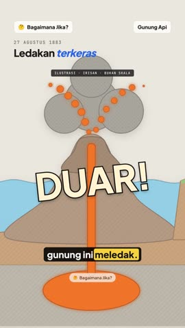</td>
<td>

**`irisanGunungApi()`** — gunung api dibelah: laut bergelombang, dasar laut (tanah + batu), dapur magma, saluran magma,
puncak, pesisir berumah. Kanvas 1000 × 1100.
- Bagian: `dapur` · `saluran` (mulai 25 % tinggi; tumbuhkan `scale: [1, 1]`) · `tubuh` (`shake`) · `puncak` (runtuh: `move [0,150]` + `fade`)
  · `abu` (tersembunyi, mengambang) · `lontaran`, `lontaran2` (lava terlontar, tersembunyi) · `gelombang` (punuk tsunami, tersembunyi;
  `scale [1,1.8]` + `move [170,0]`)
- View: `utuh` · `kawah` · `laut`
- Contoh: `krakatau.ts` adegan "meledak" & "laut bangkit".
</td></tr>
<tr>
<td>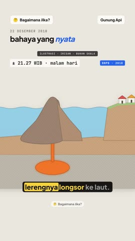</td>
<td>

**`irisanLongsorLereng()`** — gunung kecil (Anak Krakatau) dibelah; lereng kanan bisa longsor ke laut lalu memicu gelombang.
- Bagian: `lereng` (`shake` lalu `move [150,110]` + `turn 22`) · `gelombang` (tersembunyi)
- View: `utuh` · `lereng`
- Cocok juga untuk: longsor tebing, tanggul jebol, tambang runtuh (ganti warna lewat salinan).
</td></tr>
<tr>
<td>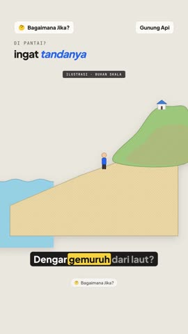</td>
<td>

**`irisanPantai()`** — pantai dari samping: laut, pasir landai, bukit + rumah di atas, orang di pantai.
- Bagian: `laut` (surut: `move [-260,70]`) · `orang` (lari: `bob` cepat + `move [330,-300]`) · `gemuruh` (busur suara, tersembunyi)
  · `jangkar-laut` (titik label di laut)
- View: `utuh` · `bukit`
- Cocok untuk: tanda bahaya tsunami, pasang-surut, abrasi, evakuasi.
</td></tr>
<tr>
<td>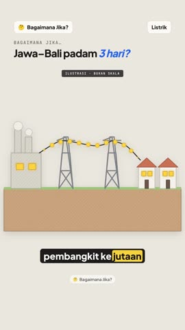</td>
<td>

**`irisanJaringanListrik()`** — pembangkit berasap → dua menara transmisi → dua rumah berjendela menyala; listrik mengalir di kabel.
- Bagian: `pembangkit` (jangkar label) · `kabel2` (putus: `shake` lalu `turn 38`) · `listrik` (aliran; `hilang` = berhenti)
  · jendela `j1` `j1b` `j2` `j2b` (padam: `color` → `#55595f`) · `titik-putus`
- View: `utuh` · `putus`
- Cocok untuk: tarif listrik, PLTS/PLTU, pemadaman, energi.
</td></tr>
<tr>
<td>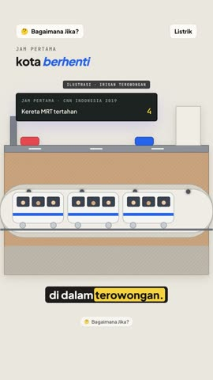</td>
<td>

**`irisanTerowongan()`** — jalan raya di permukaan, tanah berlapis, terowongan beton berlampu, kereta 3 gerbong berpenumpang.
- Bagian: `mrt` (mulai di luar layar kiri; masuk: `move [-60,0]`) · `lampu0..3` (padam: `color`) · `jangkar-mrt`
- View: `utuh`
- Cocok untuk: MRT/LRT, terowongan tol, pipa bawah tanah, banjir terowongan.
</td></tr>
<tr>
<td>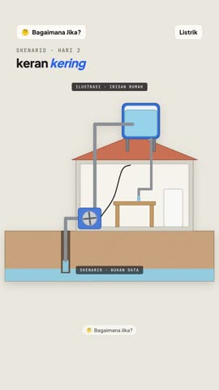</td>
<td>

**`irisanPompaAir()`** — rumah dibelah: sumur → pompa listrik (kipas berputar) → toren di atap → keran dapur menetes; kabel listrik ke pompa.
- Bagian: `kipas` (berputar; berhenti: `spin speed -2` dengan `at` = `stopAt`) · `aliran` (air di pipa) · `setrum` (listrik di kabel)
  · `tetes` (keran) · `air-toren` (menyusut: `scale [1,0.08]`) · `jangkar-pompa`
- View: `utuh` · `toren`
- Cocok untuk: PDAM, kekeringan, tagihan air, cara kerja pompa.
</td></tr>
</table>

**Potongan 2D** untuk merakit irisan baru: `rumahKecil2D(x, y, atap)` · `pesisir2D` (daratan + 2 rumah di kanan) ·
`rumahLampu2D(x, idJendela)` (jendela `<id>` & `<id>b` menyala) · `menaraListrik2D(x)` · `kereta2D(x)`.

---

## 3. Benda & dunia 3D (`src/worlds/benda.ts`)

<table>
<tr>
<td width="140">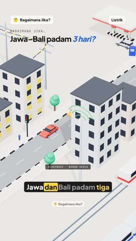</td>
<td>

**Kota** (rakitan di `listrik-padam.ts`): `gedungBerjendela([...])` (jendela `j0…` menyala; padamkan semua lewat
`ubah: Object.fromEntries(kota.jendela.map((id) => [id, { color: WARNA.mati }]))`) + `road` + mobil + `lampuLalin('lalin', pos)`
(`lalin-hijau` dimatikan dengan `color`) + `menaraBts('bts', pos)` (`bts-sinyal0..2` diredupkan `fade`) + `pembangkit(id, x, z)`
+ `menaraListrik(id, x, z)` + kabel `tube` + aliran `flow`.
</td></tr>
<tr>
<td>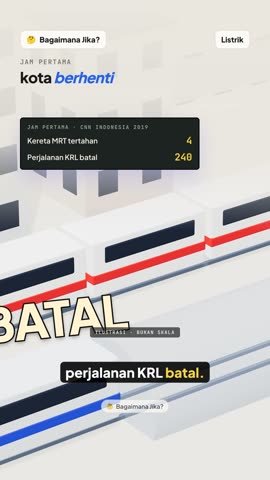</td>
<td>

**`kereta(id, pos, warnaBadan, warnaStrip, gerbong=3)`** + **`rel(x)`** — KRL (putih-merah) / MRT (putih-biru). Di gambar: panel layar
yang barisnya bertambah (`showAt`).
</td></tr>
<tr>
<td>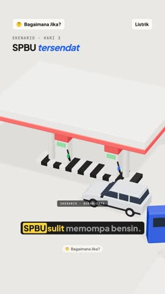</td>
<td>

**`spbu(id, pos)`** — gaya R2: kanopi merah-putih, dua dispenser (layar `spbu-layar1/2`, selang, nozzle `spbu-nozzle`),
pulau beton belang hitam-putih, mobil sedang mengisi.
</td></tr>
<tr>
<td>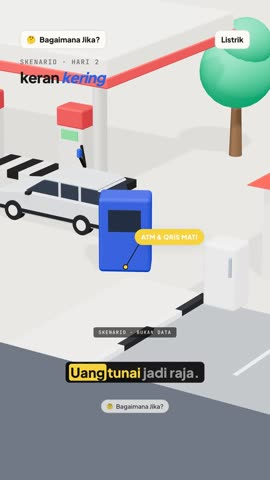</td>
<td>

**`atm(id, pos, rotate)`** (layar `atm-layar`; mati = warna gelap) · tumpukan koin `{ shape: 'coins', hidden: true }` + `muncul` + cap "TUNAI".
</td></tr>
<tr>
<td>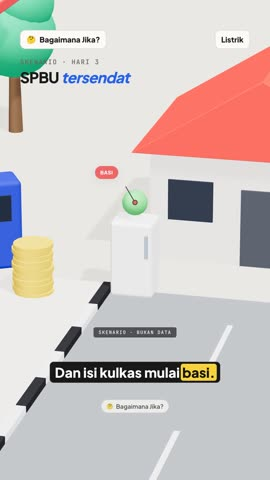</td>
<td>

**`kulkas(id, pos)`** (`kulkas-isi` tersembunyi → `muncul`, lalu `color` coklat = basi) · **`toren(id, pos)`** · **`rumah`** (`house` bawaan).
</td></tr>
<tr>
<td>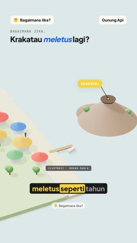</td>
<td>

**Pulau & laut** (rakitan di `krakatau.ts`): lantai `WARNA.laut`, **`gunungApi(id, pos)`** (jangkar `<id>-kawah`), pesisir
(kotak pasir + darat + tanggul), **`rumahMini(pos, atap)`**, **`pohon(pos, skala)`**, bukit `cone`, dermaga.
Efek: **`cincin(id, pos, r, tebal, warna)`** + **`membesar(to, at, durasi)`** = gelombang suara/tsunami melebar;
`flow` lava + bola `abu` yang `scale` membesar.
</td></tr>
</table>

---

## 4. HUD (berlaku di dunia 3D & irisan)

<table>
<tr>
<td width="140">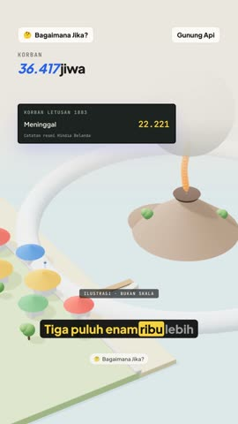</td>
<td>

**Panel layar gelap** — angka mesin tik yang menghitung; cocok untuk korban, harga, liter, jarak. Bertahan lintas adegan.
```ts
panel: {
  title: 'Korban letusan 1883',
  rows: [{ label: 'Meninggal', value: 0, to: 36417, at: 'Tiga', duration: 2, color: '#f6d23f' }],
  note: 'Catatan resmi Hindia Belanda',
},
```
Baris pembanding yang menyusul: `{ label: 'Perjalanan KRL batal', value: 0, to: 240, showAt: 'Dua', at: 'Dua' }`. `panel: false` = hapus.
</td></tr>
<tr>
<td>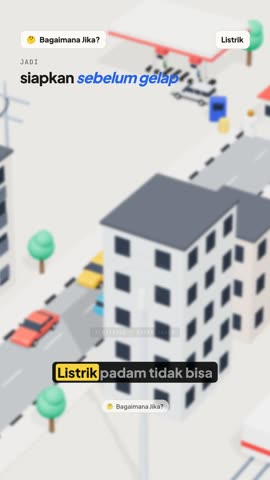</td>
<td>

**Kartu putusan kuning** — kesimpulan/ajakan; boleh berisi ✓/✕ dan stabilo.
```ts
kartu: [{ gaya: 'putusan', text: 'Siapkan di rumah', at: 'bertahan',
  points: [{ text: 'Uang tunai', ok: true, at: 'tunai' }, { text: 'Stok air galon', ok: true, at: 'stok' }] }],
// atau satu kalimat: { gaya: 'putusan', text: 'Air surut? Lari ke tempat tinggi.', sorot: ['tempat tinggi'] }
```
Kartu **kutipan**: `{ gaya: 'kutipan', text: '…', sorot: ['frasa'], source: 'Buku manual, hlm. 43' }`.
</td></tr>
</table>

Lainnya (sudah ada sejak R1): strip `data` + lencana sumber (`tone`: `data` / `ilustrasi` / `hitungan`), panel batang `meter`
(mis. "Lama padam: 2019 ±34 jam vs skenario 72 jam"), `cap` ("PADAM", "DUAR!", "TANPA GEMPA", "72 JAM"), label pil kuning
(merah `#e5484d` untuk bahaya, hijau `#16a34a` untuk aman, biru untuk air).

---

## 5. Resep adegan (pola yang terbukti enak dilihat)

| Pola | Cara (salin dari file video) |
|---|---|
| **Masuk ke dalam benda** | Adegan 3D → adegan `gambar: '<irisan>'` (transisi fade otomatis) → kembali 3D; keadaan keduanya bersambung |
| **Tumbuh dari dasar** (magma naik, air naik) | bagian ber-`origin` di dasar + `motion: [{ type: 'scale', to: [1, 0.25], at: 0, duration: 0.01 }]`, lalu `gerak: { id: [{ type: 'scale', to: [1, 1], at: 'kata' }] }` |
| **Meledak** | `shake` di tubuh (`stopAt` beberapa detik) + `muncul` abu & lontaran + `cap: { text: 'DUAR!' }` |
| **Gelombang menuju pesisir** | `muncul` punuk + `scale [1, 1.8]` + `move [x, 0]` 2,5 dtk; label biru "Gelombang 30–40 m" |
| **Putus / padam** | `shake` lalu `turn` di kabel, `hilang` aliran, jendela/lampu `color` → abu-abu, `cap: 'PADAM'` |
| **Mesin berhenti** | `spin` berlawanan arah dengan `at` = `stopAt` = kata "berhenti" (melambat halus), aliran `hilang` |
| **Orang lari** | `bob` cepat (`period: 0.35`) + `move` ke tempat tinggi + kamera `bukit` + label hijau |
| **Angka besar** | panel layar menghitung (`value → to`), bab berganti dengan judul = angkanya ("36.417 jiwa") |
| **Data vs skenario** | `meter` 2 batang: data (hitam) lalu skenario (merah, `showAt`) + `catatan: 'Skenario · bukan data'` |
| **Penutup** | kamera kembali ke view pembuka + kartu putusan kuning |

Patokan: 15–16 adegan ≈ 50–55 dtk; ±1/3 adegan irisan, sisanya 3D. Render 2 video (3D primitif + irisan) ±40 menit di sesi cloud.
